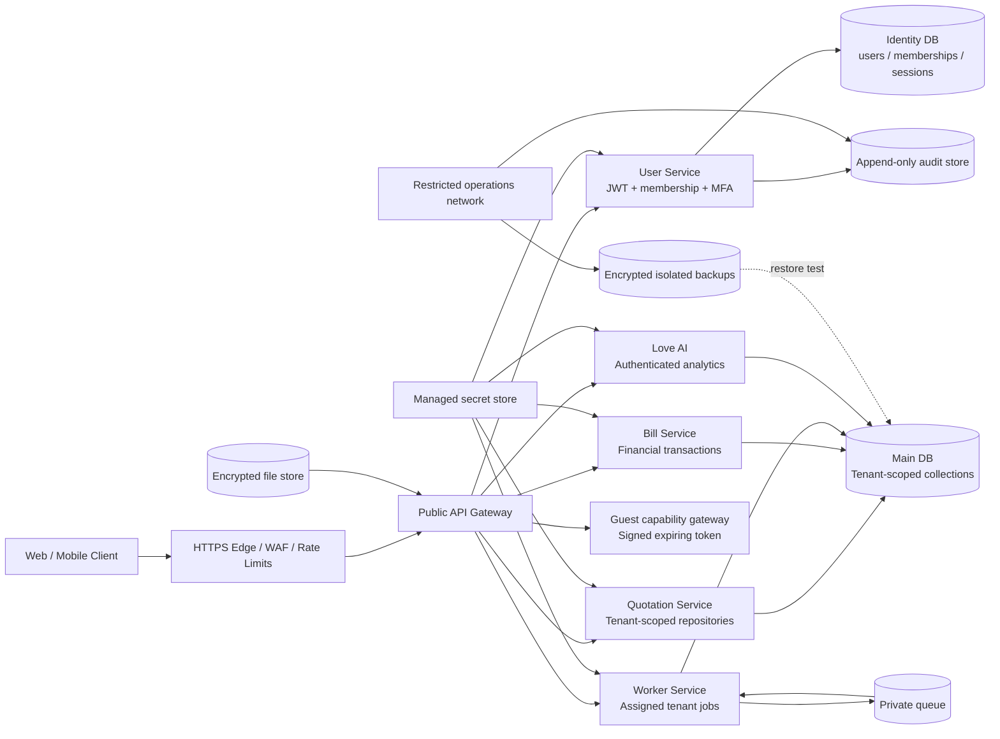

# Secure Architecture and Network Diagram

## Network rules

- Only the edge is internet-facing. Database, queue, secrets, backup, and management networks are private.
- Each service has a separate database identity and secret scope.
- Internal service calls use TLS/private networking and scoped credentials; no database master key is sent to a client or general bot.
- Guest capability endpoints are isolated from staff routes and return minimized fields.
- Audit and backup stores are not writable by ordinary application identities.

The diagram is an architecture target. Deployment firewall and cloud/IAM evidence must be attached before release.
